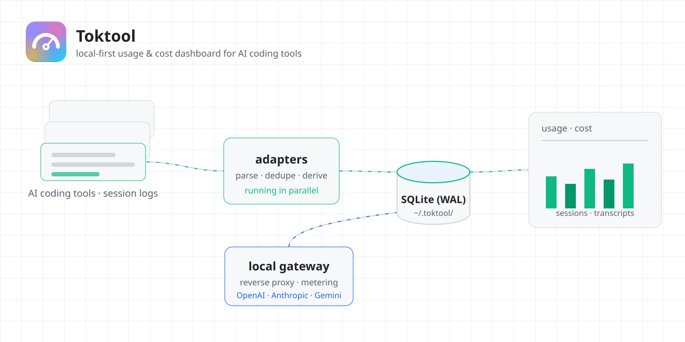
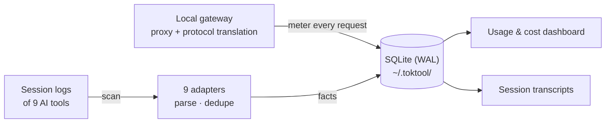

<div align="center">

# Toktool

<strong>A local-first usage &amp; cost dashboard for AI coding tools.</strong>

<p>
  <a href="README.zh-CN.md">简体中文</a>
</p>

<p>
  <a href="https://github.com/looplock/toktool/actions/workflows/ci.yml"></a>
  <a href="https://github.com/looplock/toktool/releases/latest"></a>
  
  <a href="LICENSE"></a>
  <a href="https://tauri.app/"></a>
  <a href="https://react.dev/"></a>
  <a href="https://www.rust-lang.org/"></a>
  <a href="https://www.typescriptlang.org/"></a>
</p>

</div>

<p align="center">
  <a href="docs/images/cover-light.svg">
    <picture>
      <source media="(prefers-color-scheme: dark)" srcset="docs/images/cover.svg">
      
    </picture>
  </a>
</p>

## Screenshots

<table>
  <tr>
    <td align="center" width="50%"><strong>Overview</strong></td>
    <td align="center" width="50%"><strong>Details</strong></td>
  </tr>
  <tr>
    <td align="center" width="50%">
      <a href="docs/images/overview-light.png">
        <picture>
          <source media="(prefers-color-scheme: dark)" srcset="docs/images/overview-dark.png">
          
        </picture>
      </a>
    </td>
    <td align="center" width="50%">
      <a href="docs/images/details-light.png">
        <picture>
          <source media="(prefers-color-scheme: dark)" srcset="docs/images/details-dark.png">
          
        </picture>
      </a>
    </td>
  </tr>
  <tr>
    <td align="center" width="50%"><strong>Dashboard cards</strong></td>
    <td align="center" width="50%"><strong>Gateway</strong></td>
  </tr>
  <tr>
    <td align="center" width="50%">
      <a href="docs/images/overview-cards-light.png">
        <picture>
          <source media="(prefers-color-scheme: dark)" srcset="docs/images/overview-cards-dark.png">
          
        </picture>
      </a>
    </td>
    <td align="center" width="50%">
      <a href="docs/images/gateway-light.png">
        <picture>
          <source media="(prefers-color-scheme: dark)" srcset="docs/images/gateway-dark.png">
          
        </picture>
      </a>
    </td>
  </tr>
</table>

## Background

Every AI coding tool you use already writes session logs on your machine.

But none of them tell you what a month of coding actually cost.

Toktool fills that gap locally: it scans those logs, aggregates token usage and estimated cost into a local SQLite database, and visualizes it.

A second feature ships alongside: a **local AI API gateway** (reverse proxy + protocol translation + metering), so traffic through the gateway is counted too.

Supported tools: Claude Code, Codex, OpenCode, ZCode, CodeBuddy, WorkBuddy, Grok, Pi, DSH.



## Privacy guarantees

Toktool reads tool logs read-only and never modifies them; deleting a session goes to the OS trash, never a hard delete.

It never reads API keys, tokens, or environment variables.

> [!IMPORTANT]
> All data stays in `~/.toktool/` — no account, no telemetry, no cloud sync.

Unpriced models show "unknown".

## Install

Grab an installer for your platform from the [Releases](../../releases) page.

> [!WARNING]
> The bundles are **not code-signed yet** — Windows SmartScreen and macOS Gatekeeper show a one-time security prompt on first launch. Expected, not tampering.

Verify the SHA-256 digest shown on each release asset, or build from source.

Walkthrough: [docs/install.md](docs/install.md) (Chinese).

## Usage

- **Overview dashboard** — token usage and estimated cost at a glance, with time / tool / project / model filters and an adjustable card layout.
- **Sessions** — every session with its full transcript: searchable, paged, multi-GB logs included.
- **Gateway** — point local tools at the local endpoint, manage upstreams and mappings, and meter every request that passes through.
- **Always on duty** — background scan loop with a system tray, low-power mode, and autostart.

## Supported tools

| Tool | Usage & cost | Transcript | Thinking | Images | Request duration | Trash delete | Source |
|---|---|---|---|---|---|---|---|
|  **Claude Code** | ✅ | ✅ | ✅ | ✅ | ✅ | ✅ | Local logs (JSONL) |
|  **Codex** | ✅ | ✅ | ✅ | ❌ | ✅ | ✅ | Local logs (JSONL) |
|  **CodeBuddy** | ✅ | ✅ | ✅ | ❌ | ✅ | ✅ | App database (SQLite) |
| <picture><source media="(prefers-color-scheme: dark)" srcset="docs/images/tool-icons/pi-dark.svg"></picture> **Pi** | ✅ | ✅ | ✅ | ✅ | ✅ | ✅ | Local logs (JSONL) |
| <picture><source media="(prefers-color-scheme: dark)" srcset="docs/images/tool-icons/opencode-dark.svg"></picture> **OpenCode** | ✅ | ✅ | ✅ | ✅ | ✅ | ✅ | App database (SQLite) |
| <picture><source media="(prefers-color-scheme: dark)" srcset="docs/images/tool-icons/zcode-dark.svg"></picture> **ZCode** | ✅ | ✅ | ✅ | ✅ | ✅ | ✅ | App database + log files |
|  **DSH** | ✅ | ✅ | ✅ | ✅ | ❌ | ✅ | Local logs (zstd-compressed) |
|  **WorkBuddy** | ✅ | ✅ | ✅ | ✅ | ✅ | ✅ | Local logs (JSONL) |
| <picture><source media="(prefers-color-scheme: dark)" srcset="docs/images/tool-icons/grok-dark.svg"></picture> **Grok** | ✅ | ✅ | ❌ | ✅ | ✅ | ✅ | Local logs (JSONL) |

Session deletion always goes to the OS trash — never a hard delete — including DB-backed tools (rows are exported to a JSON bundle and trashed first).

*All product names, logos, and brands are the property of their respective owners. Toktool is an independent tool and is not affiliated with any of them.*

## FAQ

<details>
<summary>Does Toktool upload my data anywhere?</summary>

No. It works fully offline — you can keep it air-gapped and nothing breaks.

</details>

<details>
<summary>How is cost estimated?</summary>

Prices come from the models.dev catalog (synced on the Pricing page) combined with your own overrides in `~/.toktool/pricing-overrides.json`. Missing cache-read / cache-write prices fall back to the input price.

</details>

<details>
<summary>Why does a model show "unknown" cost?</summary>

Because its price is not known — Toktool never invents a number.

</details>

<details>
<summary>How large can a session be?</summary>

Multi-GB session logs open instantly: transcripts are read through paged byte-range reads instead of loading whole files.

</details>

<details>
<summary>Where is my data stored?</summary>

Everything lives in a single `~/.toktool/` directory. Delete it and Toktool is gone — no scattered state, no cloud copies.

</details>

## Development

Requirements: Node.js 22+, pnpm 12 (pinned via `packageManager`), Rust stable (MSRV declared as `rust-version` in the root `Cargo.toml`), and the [Tauri 2 platform prerequisites](https://tauri.app/start/prerequisites/).

```bash
pnpm install          # JS dependencies
pnpm tauri dev        # build the Rust shell and open the app window
```

The dev server occupies port 21720 and fails loudly when it is taken — the Tauri config points at it explicitly.

## Tech stack

| Layer | Choice |
|---|---|
| Desktop shell | Tauri 2 (`single-instance`, `autostart`, `opener` plugins) |
| Systems language | Rust (stable, edition 2024) — `toktool-core` (domain) + `toktool-gateway` (axum + tokio) |
| Frontend | React 19 + TypeScript (strict) + Vite 7, pnpm |
| Styling | Tailwind CSS 4 |
| Charts | ECharts 6, driven by a hand-written React hook |
| Storage | SQLite (WAL mode) under `~/.toktool/` |

`toktool-core` must never depend on the gateway or the shell. Business logic in the shell crate is rejected in review.

## Contributing

Architecture rules, quality gates, versioning, and the release process live in [CONTRIBUTING.md](CONTRIBUTING.md). Security topics follow [SECURITY.md](SECURITY.md).

## Project documents

- [Installing releases](docs/install.md) — unsigned-installer walkthrough, SHA256 verification, and building from source (Chinese)
- [Changelog](CHANGELOG.md) — what changed in each release
- [Security](SECURITY.md) — how to report vulnerabilities and privacy-red-line violations

## License

MIT — see [LICENSE](LICENSE).
