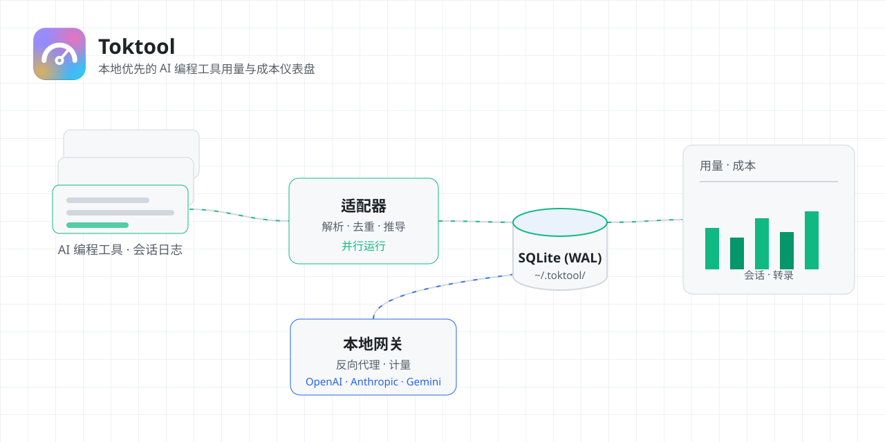
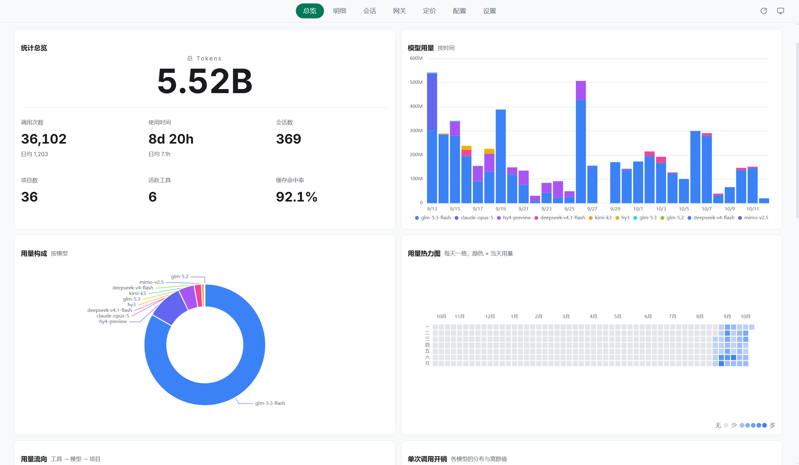
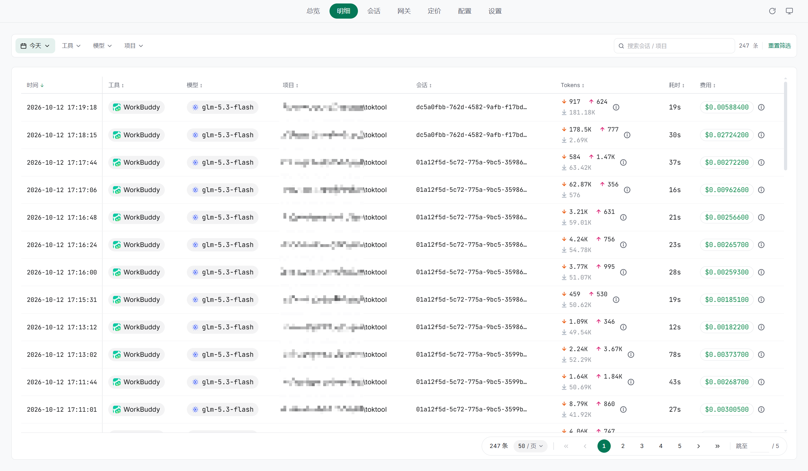
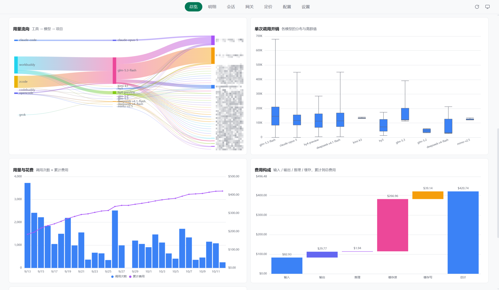
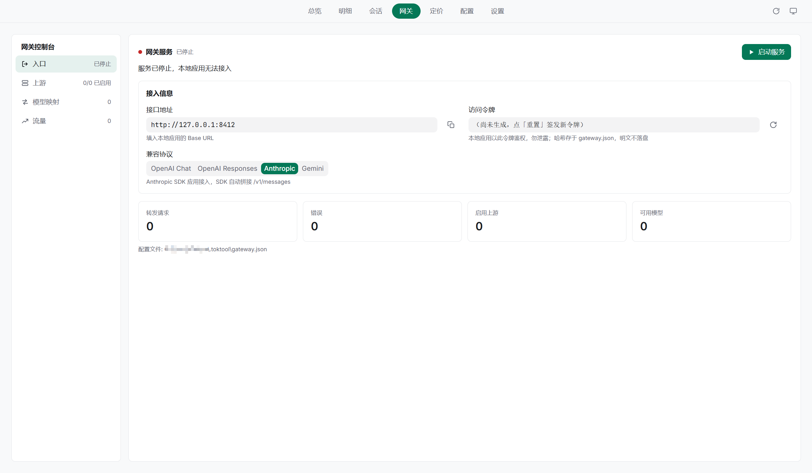
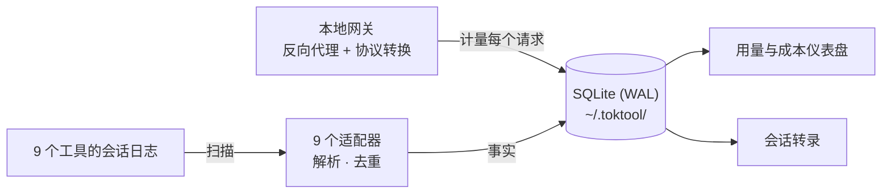

<div align="center">

# Toktool

<strong>本地优先的 AI 编程工具用量与成本仪表盘。</strong>

<p>
  <a href="README.md">English</a>
</p>

<p>
  <a href="https://github.com/looplock/toktool/actions/workflows/ci.yml"></a>
  <a href="https://github.com/looplock/toktool/releases/latest"></a>
  
  <a href="LICENSE"></a>
  <a href="https://tauri.app/"></a>
  <a href="https://react.dev/"></a>
  <a href="https://www.rust-lang.org/"></a>
  <a href="https://www.typescriptlang.org/"></a>
</p>

</div>

<p align="center">
  <a href="docs/images/cover-zh-light.svg">
    <picture>
      <source media="(prefers-color-scheme: dark)" srcset="docs/images/cover-zh.svg">
      
    </picture>
  </a>
</p>

## 截图

<table>
  <tr>
    <td align="center" width="50%"><strong>统计总览</strong></td>
    <td align="center" width="50%"><strong>请求明细</strong></td>
  </tr>
  <tr>
    <td align="center" width="50%">
      <a href="docs/images/overview-light.png">
        <picture>
          <source media="(prefers-color-scheme: dark)" srcset="docs/images/overview-dark.png">
          
        </picture>
      </a>
    </td>
    <td align="center" width="50%">
      <a href="docs/images/details-light.png">
        <picture>
          <source media="(prefers-color-scheme: dark)" srcset="docs/images/details-dark.png">
          
        </picture>
      </a>
    </td>
  </tr>
  <tr>
    <td align="center" width="50%"><strong>仪表盘卡片</strong></td>
    <td align="center" width="50%"><strong>本地网关</strong></td>
  </tr>
  <tr>
    <td align="center" width="50%">
      <a href="docs/images/overview-cards-light.png">
        <picture>
          <source media="(prefers-color-scheme: dark)" srcset="docs/images/overview-cards-dark.png">
          
        </picture>
      </a>
    </td>
    <td align="center" width="50%">
      <a href="docs/images/gateway-light.png">
        <picture>
          <source media="(prefers-color-scheme: dark)" srcset="docs/images/gateway-dark.png">
          
        </picture>
      </a>
    </td>
  </tr>
</table>

## 背景

你在用的每个 AI 编程工具其实都在本机写会话日志。

但没有一个会告诉你，一个月写下来到底花了多少钱。

Toktool 在本地补上这块：扫描这些日志，把 token 用量与估算成本汇总进本地 SQLite 并可视化。

随附的第二个功能是**本地 AI API 网关**（反向代理 + 协议转换 + 计量），网关流量同样计入统计。

支持的工具：Claude Code、Codex、OpenCode、ZCode、CodeBuddy、WorkBuddy、Grok、Pi、DSH。



## 隐私红线

Toktool 只读取工具日志、绝不修改，删除会话仅走系统回收站，绝不硬删除。

绝不读取 API key、token 或环境变量。

> [!IMPORTANT]
> 所有数据只留在 `~/.toktool/`——没有账号，没有遥测，没有云端同步。

没有已知价格的模型显示"未知"。

## 安装

从 [Releases](../../releases) 页下载对应平台的安装包。

> [!WARNING]
> 发布产物**未做代码签名**——Windows SmartScreen 与 macOS Gatekeeper 首次运行会出示一次性安全提示。属预期行为，不是安装包被篡改。

安装前请核对 release 产物自带的 SHA-256 摘要，或从源码自建。

详细步骤见 [docs/install.md](docs/install.md)。

## 使用

- **概览仪表盘**——token 用量与估算成本一屏总览，支持时间 / 工具 / 项目 / 模型筛选，卡片布局可自由调整。
- **会话**——每个会话的完整转录：可搜索、可分页，多 GB 日志也能秒开。
- **网关**——把本地工具指到本机端点，管理上游与映射，经过的每个请求都被计量。
- **常驻后台**——后台扫描循环 + 系统托盘，支持低功耗模式与开机自启。

## 支持的工具

| 工具 | 用量与成本 | 会话转录 | 思考块 | 图片附件 | 按请求耗时 | 删除到回收站 | 数据来源 |
|---|---|---|---|---|---|---|---|
|  **Claude Code** | ✅ | ✅ | ✅ | ✅ | ✅ | ✅ | 本地日志（JSONL） |
|  **Codex** | ✅ | ✅ | ✅ | ❌ | ✅ | ✅ | 本地日志（JSONL） |
|  **CodeBuddy** | ✅ | ✅ | ✅ | ❌ | ✅ | ✅ | 应用数据库（SQLite） |
| <picture><source media="(prefers-color-scheme: dark)" srcset="docs/images/tool-icons/pi-dark.svg"></picture> **Pi** | ✅ | ✅ | ✅ | ✅ | ✅ | ✅ | 本地日志（JSONL） |
| <picture><source media="(prefers-color-scheme: dark)" srcset="docs/images/tool-icons/opencode-dark.svg"></picture> **OpenCode** | ✅ | ✅ | ✅ | ✅ | ✅ | ✅ | 应用数据库（SQLite） |
| <picture><source media="(prefers-color-scheme: dark)" srcset="docs/images/tool-icons/zcode-dark.svg"></picture> **ZCode** | ✅ | ✅ | ✅ | ✅ | ✅ | ✅ | 应用数据库 + 日志文件 |
|  **DSH** | ✅ | ✅ | ✅ | ✅ | ❌ | ✅ | 本地日志（zstd 压缩） |
|  **WorkBuddy** | ✅ | ✅ | ✅ | ✅ | ✅ | ✅ | 本地日志（JSONL） |
| <picture><source media="(prefers-color-scheme: dark)" srcset="docs/images/tool-icons/grok-dark.svg"></picture> **Grok** | ✅ | ✅ | ❌ | ✅ | ✅ | ✅ | 本地日志（JSONL） |

会话删除一律走系统回收站，绝不硬删除——数据库类工具同样如此（会话行先导出为 JSON 包入桶，再从库中删除）。

*所有产品名称、图标与品牌均归其各自所有者所有。Toktool 为独立工具，与上述产品无隶属或合作关联。*

## 常见问题

<details>
<summary>Toktool 会把我的数据上传到哪里吗？</summary>

不会。它完全离线工作，断网运行也不受任何影响。

</details>

<details>
<summary>成本是怎么估算的？</summary>

价格来自 models.dev 目录（定价页内同步），叠加你在 `~/.toktool/pricing-overrides.json` 里的手写覆盖价；缺失的缓存读/写价格回退到输入价。

</details>

<details>
<summary>为什么有的模型成本显示"未知"？</summary>

因为它的价格未知——Toktool 绝不编造数字。

</details>

<details>
<summary>会话可以有多大？</summary>

多 GB 的会话日志也能秒开：转录走分页字节区间读取，不需要整个文件载入。

</details>

<details>
<summary>数据存在哪里？</summary>

一切都在 `~/.toktool/` 这一个目录里。删掉目录，Toktool 就彻底消失——没有散落状态，没有云端副本。

</details>

## 开发

环境要求：Node.js 22+、pnpm 12（由 `packageManager` 锁定）、Rust stable（MSRV 见根 `Cargo.toml` 的 `rust-version` 字段），以及 [Tauri 2 平台构建依赖](https://tauri.app/start/prerequisites/)。

```bash
pnpm install          # 安装 JS 依赖
pnpm tauri dev        # 编译 Rust 壳并打开应用窗口
```

dev server 固定占用 21720 端口，被占用时直接失败——Tauri 配置写死了这个地址。

## 技术栈

| 层 | 选型 |
|---|---|
| 桌面壳 | Tauri 2（`single-instance`、`autostart`、`opener` 插件） |
| 系统语言 | Rust（stable，edition 2024）——`toktool-core`（领域）+ `toktool-gateway`（axum + tokio） |
| 前端 | React 19 + TypeScript（strict）+ Vite 7，包管理 pnpm |
| 样式 | Tailwind CSS 4 |
| 图表 | ECharts 6，配自写 React hook |
| 存储 | SQLite（WAL 模式），位于 `~/.toktool/` |

`toktool-core` 绝不允许依赖网关或壳；壳里写业务逻辑会在评审时被打回。

## 参与贡献

架构铁律、质量门禁、版本管理与发布流程见 [CONTRIBUTING.md](CONTRIBUTING.md)；安全话题遵循 [SECURITY.md](SECURITY.md)。

## 项目文档

- [安装发布版](docs/install.md) —— 未签名提示的处理、SHA256 核验与源码自建
- [更新日志](CHANGELOG.md) —— 每个版本改了什么
- [安全策略](SECURITY.md) —— 如何报告漏洞与隐私红线违规

## 许可证

MIT —— 见 [LICENSE](LICENSE)。
